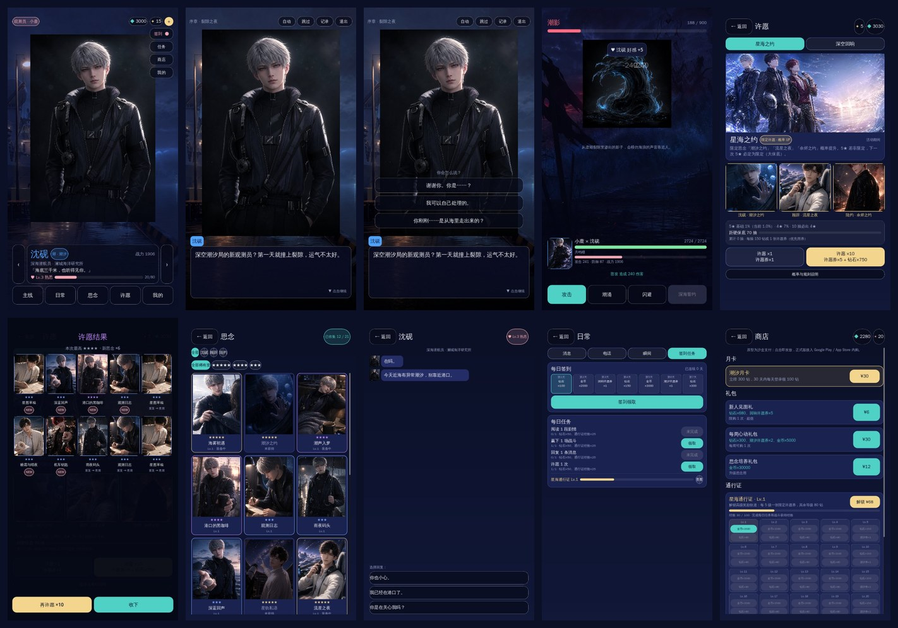
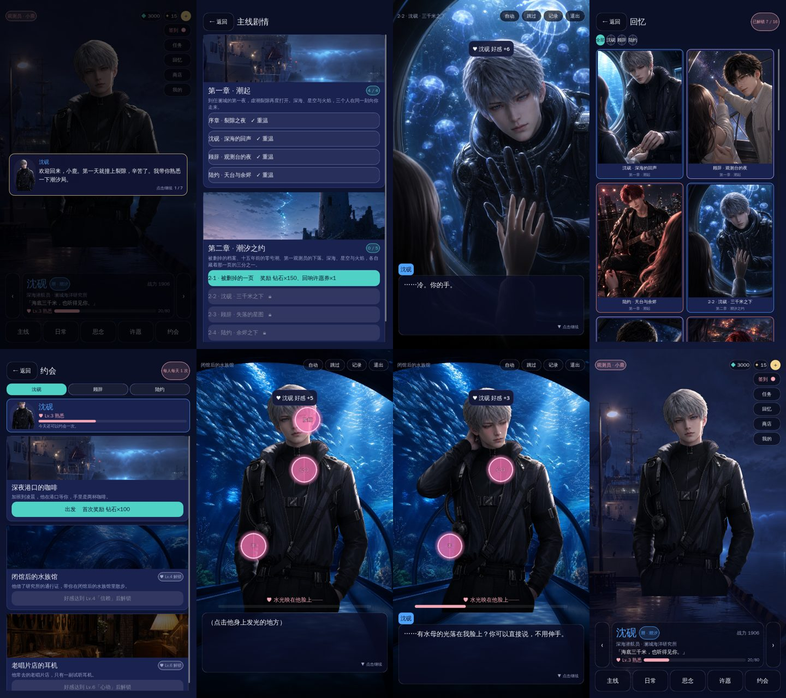

# 深与空恋 · Deep & Sky Love

面向女性玩家的移动端乙女恋爱游戏原型（Godot 4.4，GDScript，竖屏 1080×1920）。
玩法框架参考《恋与深空》一类头部乙游：主线剧情 + 好感养成 + 思念卡抽取与培养 + 轻量战斗 + 短信/电话/瞬间等日常陪伴 + 月卡/礼包/通行证商业化。
美术资源由 image 2（OpenAI 兼容网关）按 `assets/manifest.json` 批量生成，当前仓库内为占位图。

## 运行

1. 安装 [Godot 4.4](https://godotengine.org/download)（标准版即可）。
2. 用 Godot 打开本目录的 `project.godot`，按 F5 运行。桌面窗口按 450×800 显示，手机导出时按实际屏幕自适应（`canvas_items` + `expand`）。
3. 手机真机：Project → Export，`export_presets.cfg` 里已有 Android / iOS 预设（需自行安装导出模板与签名）。

无头自检（CI 可用）：

```bash
godot --headless --path . --import                    # 首次导入资源
godot --headless --path . -- --test                   # 逻辑测试：数据完整性 / 抽卡保底 / 好感 / 存档
xvfb-run godot --path . --rendering-method gl_compatibility -- --shots=shots   # 自动截图各界面
```

## 界面一览



主页 / 剧情 / 选项 / 战斗 / 许愿 / 许愿结果 / 思念 / 短信 / 签到任务 / 商店（均为占位图，由 `ShotRunner` 自动截取，见 `docs/screenshots/`）。

## 玩法与系统

| 系统 | 说明 | 代码 |
| --- | --- | --- |
| 剧情 | 视觉小说：背景 / 立绘 / 打字机对话 / 选项加好感 / 剧情中穿插战斗 / 自动 / 跳过 / 记录；剧本是 JSON | `src/screens/Story.gd`，`data/story.json` |
| 好感 | 11 级好感（陌生 → 永恒），选项、短信、电话、瞬间互动都会增加；每级 +2% 战斗面板 | `src/autoload/Game.gd` |
| 许愿（抽卡） | 5★ 1%、4★ 7%，60 抽后软保底每抽 +10%，70 抽硬保底，10 抽必出 4★；限定池 50% UP + 大保底；优先用许愿券，不足用钻石（150/抽）；重复转星屑 | `src/systems/Gacha.gd`，`data/gacha.json` |
| 思念（卡牌） | 3 位男主 × 7 张（2×5★ / 2×4★ / 3×3★），升级（金币）、装备（每人 2 张）、思念故事 | `src/screens/Cards.gd`、`CardDetail.gd`，`data/cards.json` |
| 战斗 | 轻量实时：点击攻击、技能冷却、敌人预警可闪避、攒共鸣槽放搭档共鸣技；胜利给金币/钻石/经验 | `src/screens/Battle.gd`，`data/enemies.json` |
| 日常 | 短信（分支回复）、电话（好感 Lv.3 解锁）、瞬间（点赞/评论）、签到、每日任务、月卡领取 | `src/screens/Daily.gd`、`Chat.gd`、`Call.gd`，`data/messages.json` |
| 商店 | 月卡、礼包、钻石档位、通行证（免费/高级轨道）、星屑兑换。**沙盒支付**：点击即发放，正式版需接 Google Play Billing / StoreKit 并服务端验单 | `src/screens/Shop.gd`，`data/shop.json` |
| 我的 | 改名、数据、文字速度、清档；开发用的生图配置与「AI 工坊」（游戏内直接生成并替换某张图） | `src/screens/Profile.gd`，`src/autoload/ImageGen.gd` |

存档为 `user://save.json`（Android 在 app 私有目录），结构见 `Game.default_state()`。

## 世界观与角色（原创）

2049 年海滨都市澜城。十五年前「虚潮裂隙」打开，名为「潮影」的异常体从深海与夜空之间渗入城市。你是深空潮汐局的新任观测员，唯一能同时听见深海与星空回响、并与回响者「共鸣」的人。

| 角色 | 身份 | 能力 | 一句话 |
| --- | --- | --- | --- |
| 沈砚（深） | 海洋研究所首席潜航员，冷静克制 | 潮汐 | 「海底三千米，也听得见你。」 |
| 顾辞（空） | 天文台观测员 / 搜救飞行员，温柔 | 星轨 | 「每一颗星星都在替我看你。」 |
| 陆灼（炽） | 乐队「余烬」主唱 / 机车手，张扬 | 余烬 | 「别躲了，我的热度只对你开放。」 |

第一章「潮起」共 4 节（序章 + 三条个人线），第二章为预告。所有文案在 `data/*.json`，可直接改。

## 美术流水线（image 2）

```
data/*.json ──build_manifest.py──▶ assets/manifest.json ──gen_assets.py──▶ assets/gen/<key>.png
                                         │
                                         └──make_placeholders.py──▶ assets/gen/<key>.jpg（占位）
```

- `tools/build_manifest.py`：根据角色 / 卡牌 / 场景数据生成每张图的 key、比例、提示词（49 张：9 张背景、12 张立绘、21 张思念卡、2 个敌人、2 张卡池横幅、3 张瞬间照片）。
- `tools/gen_assets.py`：调用 image 2 出图。调用封装参考 drma-web（提交 → 轮询 → 下载落盘），支持两种后端：
  - `openai`（默认）：OpenAI 兼容网关 `POST /v1/images/generations`，模型 `gpt-image-2`；表情立绘与思念卡带参考图时走 `/v1/images/edits`，用 calm 立绘保证同一角色一致。
  - `drma`：drma 后端 `/videoAi/aiGenerate/add/new`（t2i / i2i）+ `/videoAi/aiCall/aiGenerateRecord/info` 轮询。
- 游戏内 `Data.texture(key)` 取图顺序：`user://gen/`（AI 工坊生成）→ `assets/gen/*.png|jpg` → 程序渐变占位，所以缺图也不会报错。

```bash
export IMAGE_API_BASE=https://ai-gateway.deepthink.works   # 默认值，可省略
export IMAGE_API_KEY=xxxx                                    # 网关密钥
python tools/gen_assets.py --probe                           # 看网关模型列表，确认 image 2 的模型名
python tools/gen_assets.py --dry-run                         # 看计划
python tools/gen_assets.py                                   # 全部生成（约 49 张）
python tools/gen_assets.py --only characters/shen_yan --force
```

生成后用 Godot 打开工程会自动导入新图；提交 `assets/gen/*.png` 与 `.import` 文件即可。
视频类资源（开场 PV、思念动态卡）可走同一网关的 minimax h3 / seedance 2.0 fast，待网关接口确认后在 `tools/` 里补 `gen_video.py`。

## 目录

```
project.godot / export_presets.cfg
src/App.tscn, App.gd          根节点：界面容器 + 浮层；--test / --shots 入口
src/autoload/                 Data（静态数据与贴图）、Game（存档数值）、UIKit（样式与控件工厂）、Router（导航、浮层、新手引导）、ImageGen（生图客户端）、Audio（BGM 与配音）
src/systems/Gacha.gd          抽卡规则（纯逻辑，可单测）
src/screens/                  各界面（全部用代码搭建，样式集中在 UIKit）
src/dev/ShotRunner.gd         自动截图
data/                         角色、思念卡、卡池、剧情、消息/电话/瞬间、商店、敌人
assets/manifest.json          美术清单（生成）；assets/gen/ 图片；assets/fonts/cjk.ttf 中文字体
tools/                        美术流水线脚本
tests/TestRunner.gd           逻辑测试
docs/                         调研报告与设计说明
```

## v0.2 新增



新手引导 / 第二章 / 剧情 CG / 回忆相册 / 约会 / 触碰互动 / 互动回应 / 抠图后的主页立绘

| 内容 | 说明 | 代码 / 数据 |
| --- | --- | --- |
| 第二章「潮汐之约」 | 5 节：被删掉的档案 → 沈砚 / 顾辞 / 陆灼三条个人线 → 终章 Boss「裂隙之心」（自动派出战力最高的男主）；新增配角说话人（`who: "npc"` + `name`） | `data/story.json` |
| 剧情 CG 与回忆 | 剧本行 `cg` / `cg_end` 铺满全屏 CG，看过即收进「回忆」相册（主页右侧入口），可全屏欣赏；主线 7 张 + 约会 9 张 | `Story.gd`、`Gallery.gd` |
| 约会 | 每位男主 3 个约会地点，好感 Lv.2 / 4 / 6 解锁，每人每天 1 次（+15 好感，首次 100 钻并解锁约会 CG）；约会里有「触碰互动」：在立绘上点亮发光部位，他会回应 | `data/dates.json`、`Dates.gd`、`Story.gd` 的 `touch` 行 |
| 新手引导 | 首次进入主页由当前男主介绍 7 个入口；第一场战斗暂停讲解攻击 / 技能 / 闪避 / 共鸣 | `Router.coach()` |
| 角色配音 | 男主的剧情、约会、电话、主页问候共 201 句，MiniMax `speech-2.8-hd`，三人三种音色；设置里可调音乐 / 配音音量 | `Audio.gd`、`tools/gen_audio.py`、`assets/audio/voice/` |
| 立绘抠图 | image 2 不支持透明背景，出图后用 BiRefNet 本地抠图，立绘不再是方框 | `tools/cutout.py` |

### 声音流水线

```bash
python tools/gen_audio.py voice      # 配音：遍历剧本里男主的台词，文件名 = md5("角色|台词")[:16]，改台词只重生成改过的句子
python tools/gen_audio.py bgm        # BGM：Mureka 纯音乐，5 首（标题、日常、剧情、紧张、战斗），提示词在 data/audio.json（下载域名 cdn.mureka.ai 需要放行）
```

音色在 `data/characters.json` 的 `voice.id`。缺配音 / 缺 BGM 时游戏静默跳过。

## 后续规划（建议）

1. 用 image 2 出正式美术并统一画风；立绘做 Live2D / 骨骼动画或用视频模型生成「动态思念」。
2. 音效；思念卡台词配音；剧情按段落切换 BGM。
3. 第三章「回响之城」；约会小游戏（拍照、抓娃娃）；主页触摸互动扩展。
4. 服务端：账号、存档云同步、内购验单、活动与卡池配置下发；生图改为服务端离线生成。
5. 上架：Android / iOS 导出模板、隐私合规、抽卡概率公示页。
